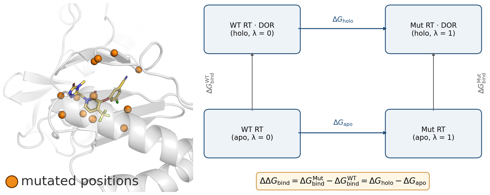

# Molecular Simulation of Doravirine Resistance in HIV-1 Reverse Transcriptase

**Rohit Satija, Kaiming Tao, and Robert W. Shafer**

Division of Infectious Diseases, School of Medicine, Stanford University

[Manuscript and supporting information](revisions/submission-ready/) · [Reproduce the results](REPRODUCE.md) · [Figures and tables](paper/ARTIFACTS.md) · [Repository guide](docs/REPOSITORY.md)



## Abstract

**Background:** Doravirine (DOR) is a second-generation non-nucleoside reverse transcriptase inhibitor (NNRTI) that retains activity against several common NNRTI resistance mutations, but phenotypic susceptibility data remain limited for many DOR-associated genotypes.

**Methods:** We evaluated whether physics-based simulations of HIV-1 reverse transcriptase (RT) could retrospectively distinguish DOR-susceptible and DOR-resistant genotypes and explain their molecular differences. We simulated wild-type (WT) RT and 18 DOR-associated genotypes spanning susceptible, resistant, and uncertain phenotypes. Mutation-induced changes in DOR binding were estimated using nonequilibrium alchemical free-energy perturbation (FEP; $ΔΔG_{bind}$) and WT-referenced MM/GBSA interaction energies ($ΔΔE_{Total}$), and compared with experimentally measured susceptibility fold-changes. We also analyzed DOR contacts, ligand positioning, and RT conformational changes in bound and unliganded simulations.

**Results:** A genotype was classified as having a high energetic impact when its estimated $ΔΔG_{bind}$ minus one standard error exceeded +0.5 kcal/mol. Under this rule, FEP classified 3 of 4 susceptible genotypes as low-impact and 7 of 9 resistant genotypes as high-impact. $ΔΔG_{bind}$ showed limited correlation with $log_{10}$-transformed susceptibility fold-change across all 18 genotypes (R² = 0.08, p = 0.26), with a stronger association among the 13 genotypes with established susceptible or resistant phenotypes (R² = 0.26, p = 0.07). MM/GBSA classified 7 of 9 resistant genotypes as high-impact but only 1 of 4 susceptible genotypes as low-impact. $ΔΔG_{bind}$ and $ΔΔE_{Total}$ were modestly correlated (R² = 0.18, p = 0.08), with van der Waals contributions frequently dominating MM/GBSA shifts. Structural analyses identified changes in aromatic packing, ligand positioning, and the conformational response to DOR binding.

**Conclusion:** Relative binding free-energy classifications agreed with established susceptibility categories for 10 of 13 genotypes, but limited quantitative correspondence with susceptibility fold-changes restricts their use as a proxy for in vitro testing. The simulations identify mutation-dependent changes in DOR contacts and pocket reorganization, providing mechanistic hypotheses that complement experimental susceptibility data.

## Reproduce the paper

The frozen reference is the JCIM revision submitted **10 November 2026** (ci-2026-030865). [REPRODUCE.md](REPRODUCE.md) covers setup, rebuilding, and simulation-data recovery. The [artifact map](paper/ARTIFACTS.md) connects each figure and table to its inputs and commands.

```bash
conda env create -f environment.yml
conda activate nnrti-prep
export PYTHONNOUSERSITE=1
python -m pip install --no-deps -e .
./workflows/05_manuscript_artifacts.sh
```

Open `paper/generated/paper/README.md` for all 22 figures and tables under their final publication labels, including exact submitted versions and supported rebuilds. `paper/generated/reproduction.json` records hashes and environment versions; `paper/generated/validation/` holds test results.

Exports and rebuilds go to ignored `paper/generated/`. The submitted Word, PDF and Excel files are protected by SHA-256 checksums and are never build destinations. Figure 1, Figure 2 and some SI tables include curated composition or experimental inputs; their exact submitted versions can be exported without recreating that manual work.

## Repository contents

| Directory | Purpose |
|---|---|
| `revisions/submission-ready/` | Frozen November submission: clean/marked manuscript, response, SI and seven workbooks |
| `paper/` | Artifact registry and map, submission checksums, editable sources and the generated paper collection |
| `src/nnrti/` | Scientific code and analysis CLIs |
| `data/`, `manifests/` | Experimental inputs, structures, preparation inputs and run provenance |
| `results/analysis/` | Derived numerical data and plots; source filenames may retain earlier figure numbers |
| `workflows/` | Preparation, simulation, analysis and manuscript entry points |
| `ops/` | Cluster jobs, transfers and document utilities |
| `archive/` | Historical materials |

Raw trajectories and large simulation intermediates are excluded from Git. See [MD run data](docs/methods/md-run-data.md) for file formats and validation, and the [documentation index](docs/README.md) for methods and operations.

[Repository structure](docs/REPOSITORY.md) defines code, data, outputs and archive roles locally and on Sherlock.

[Environment guide](docs/ENVIRONMENTS.md): local `nnrti-prep`, Sherlock simulation modules, and the optional legacy pmx tools.
